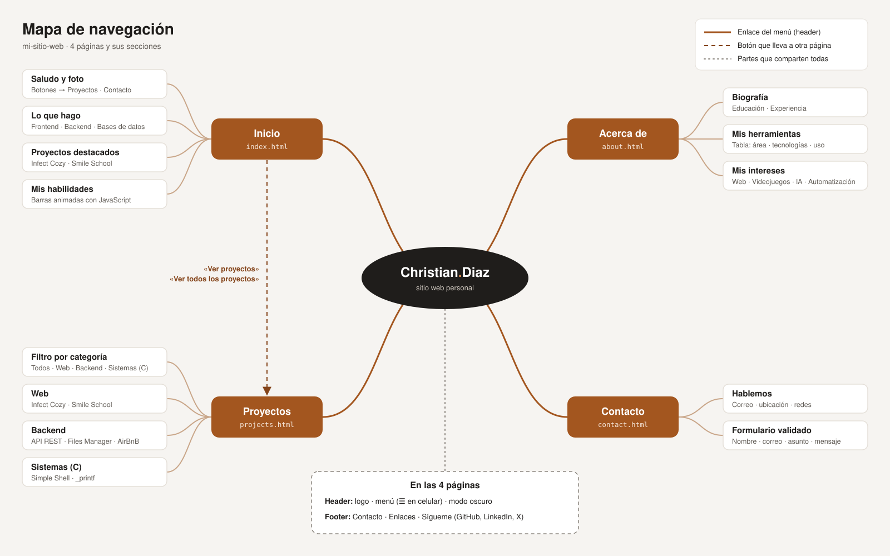

# Mi página web personal — Christian Diaz

Proyecto final de **Fundamentos de Ingeniería Informática**: sitio de 4 páginas hecho con HTML, CSS y JavaScript. La única librería externa es el web component de [Iconify](https://iconify.design/docs/iconify-icon/) para los íconos.

## Mapa de navegación

Mapa mental del sitio: en el centro el sitio, como ramas las 4 páginas (enlaces del menú) y como hojas las secciones de cada página. La línea punteada marca los botones que llevan de una página a otra y el recuadro de abajo, lo que comparten todas (header y footer).



## Estructura de archivos

```
mi-sitio-web/
├── index.html      # Inicio: presentación, servicios, proyectos destacados y habilidades
├── about.html      # Acerca de: biografía, educación, tabla de herramientas e intereses
├── projects.html   # Proyectos: 7 proyectos de GitHub con filtro por categoría
├── contact.html    # Contacto: datos y formulario validado con JavaScript
├── css/
│   └── styles.css  # Todos los estilos (una sola hoja externa)
├── js/
│   └── main.js     # Toda la interactividad (un solo archivo para las 4 páginas)
├── docs/
│   └── mapa-navegacion.svg  # Mapa mental de navegación (documentación, no lo usa el sitio)
└── img/
    ├── christian-diaz.webp
    ├── infect-cozy.webp
    └── smile-school.jpg
```
